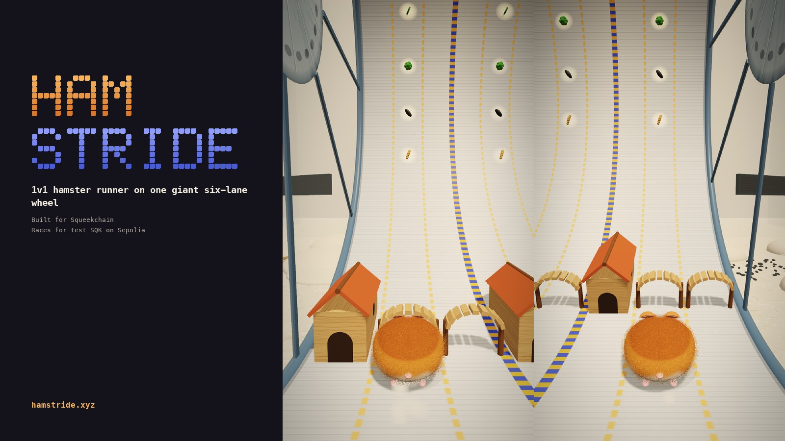
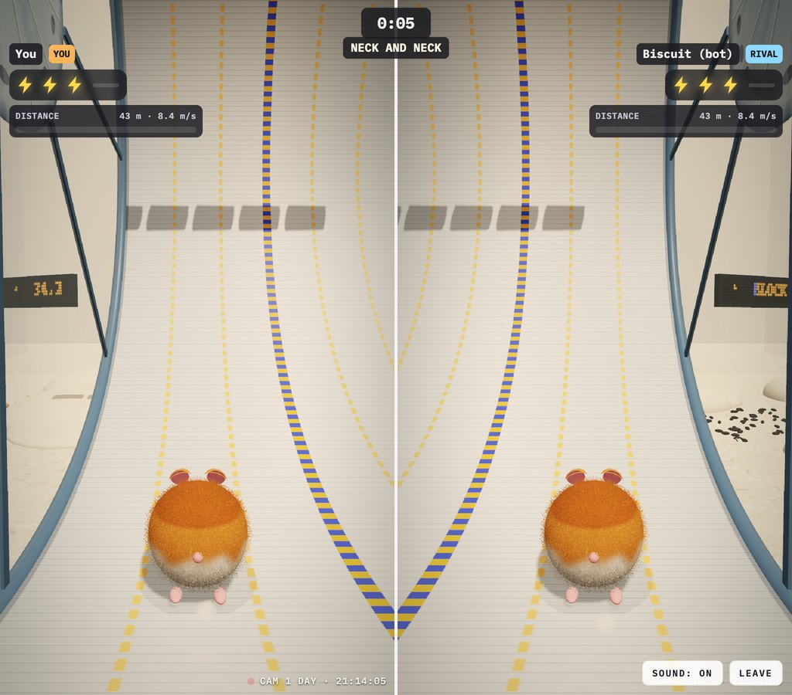

# Hamstride



A 1v1 hamster runner in the browser, built for [Squeekchain](https://squeekchain.com), the blockchain powered by a real hamster. It is an independent community project, not made by the Squeekchain team.

**Play:** [hamstride.xyz](https://hamstride.xyz) · Practice needs nothing. Online races need a wallet sign-in on the Sepolia test network (a free signature, no transaction).

Both players run on one giant six-lane hamster wheel (modelled on Squeektoshi's WHEELY9000), seen from behind. The screen splits down the middle of the wheel: you run in the left three lanes, your rival in the right three, on the same course. Use **← →** to change lanes, **↑** to jump cork logs and **↓** to slide under wooden bridges; on a phone, swipe. Hideouts and rolling chew balls are too tall: go round them. You have three ⚡ energy bolts and every bump costs one; with none left the hamster sits down to rest. A **mini wheel** makes you faster and takes one bump for you; a **hamster ball** rolls over logs and under bridges and takes one bump. Snacks (seeds, broccoli, courgette, mealworms) win a bolt back.

The wheel never stops speeding up (8 m/s, then +0.07 m/s every second), and after 90 seconds both hamsters lose a bolt every 12 seconds on their own, so every race ends with a winner, usually within a few minutes. Every 420 m the picture switches between day and an infrared night camera, like the real stream. Around the wheel is Squeektoshi's real set-up: paper bedding, cork, a sand bath, the stream cameras, and an LED board with his live numbers.

## Races for SQK

Two signed-in players can race for test SQK on Sepolia. Both put the same stake into an escrow contract; the winner takes the pot minus a fixed 5% fee, and a draw gives both stakes back with no fee.

- Contract: [`SprintEscrow` at 0x6a9E96118935ECdc30c790562CDF4b7288Bf708a](https://sepolia.etherscan.io/address/0x6a9E96118935ECdc30c790562CDF4b7288Bf708a) on Sepolia, source in [`contracts/`](contracts/contracts/SprintEscrow.sol), token [SQK](https://sepolia.etherscan.io/address/0xd78a3956cF63164d1Fa1C622ad3c66623162Fa1e).
- Matching: fixed tables (10, 50, 250, 1000 SQK) for quick match, any amount in a private room, and an open challenge board.
- The game server signs a ticket for the two wallets; each player has 2 minutes to deposit. If the rival never pays, you take your stake back.
- After the race the server signs the result (with the hash of every key press). The winner submits it and the contract pays out. With no result within 3 days, anyone can refund both stakes.
- The server's key can only say who won. The owner can withdraw only the collected fees, never the stakes, and cannot change the fee.
- The page never asks for unlimited token approvals: a permit signature, or an approval for exactly the stake.

Tested with 34 Solidity tests (`cd contracts && npx hardhat test`), an end-to-end test of the browser and server code against a local chain (`test/escrow.e2e.test.ts`) and a full server run (`scripts/e2e-room.mjs`).

An older take (each player in their own wheel, seen at 45°) is kept for reference: `npm run dev:classic` (port 5174, practice only).

| Day camera | Infrared night camera |
|---|---|
|  |  |

## Stack

- **Client:** Vite + TypeScript + Three.js. Each half renders into its own multisampled target and goes through a post pass (tone mapping, or the infrared camera look with grain and scanlines). The hamster has shell-layer fur; all textures are painted on canvases at start-up, and the site's card icons are rendered from the same 3D models.
- **Server:** one Cloudflare Worker with three SQLite-backed Durable Objects (`Room`, `Lobby`, `Board`). It runs on the Workers free plan.
- **Shared engine:** `src/shared/` is a deterministic simulation that runs in both the browser and the Worker.

## How cheating is handled

The client code is public, so the design never relies on hiding it.

| Threat | Defence |
|---|---|
| Modified client fakes speed or a finish | The server replays every player's race from their raw key presses with the same engine (`worker/room.ts`). |
| Server or player picks a favourable course | Commit-reveal: the server publishes `sha256(serverSeed)` first, both players add a random seed, and the course is built from all three. After the race the client checks everything (`showOnlineResult`). |
| Reading the course ahead | Obstacles are sent only when they are 70 m ahead of the leader. |
| Scripted players | The server times each reaction, from an obstacle coming into view in your lane to your dodge (`src/shared/stats.ts`). Runs whose reactions are faster than a human's (under 140 ms on average) or too consistent are not ranked. |
| Synthetic events in the page | Inputs with `isTrusted === false` and auto-repeat keydowns are ignored. A `navigator.webdriver` session is not ranked. |
| Mass scripted joins | Each socket needs an HMAC-signed join ticket plus a 14-bit proof of work (`worker/ticket.ts`). Each player can send at most 40 inputs per second. |
| Scripted clients in the game | Headless browsers and scripting libraries get 403 on sign-in, the game sockets and the stake flow. Pages and public read-only data (`/api/leaderboard`, `/api/challenges`, `/api/stake/config`) are open to every reader, crawler and AI agent. |

None of this makes cheating impossible. A determined bot that reads the screen can still play. The point is that it can't fake results, and it gets flagged when it plays too perfectly.

## Develop

```bash
npm install
cp .dev.vars.example .dev.vars   # then put a long random TICKET_SECRET in it
npm run build                    # the Worker serves ./dist
npx wrangler dev --port 8787     # game server + built site
npx vite --port 5173             # optional: hot reload, proxies /api and /ws to 8787
npm run dev:classic              # optional: the older 45° version on port 5174
npm test
```

## Deploy (free plan)

```bash
npx wrangler login
npx wrangler secret put TICKET_SECRET   # a long random string
npx wrangler secret put REFEREE_KEY     # only for races for SQK: the key whose address the escrow trusts
npm run deploy
```

After deploying:

1. Add your domain in Cloudflare. `wrangler.jsonc` attaches it to the Worker (`routes`) and lists it in `ALLOWED_ORIGINS`.
2. `ESCROW_ADDRESS` in `wrangler.jsonc` is the deployed SprintEscrow contract on Sepolia.
3. To get the project onto the Squeekchain Genesis board, add the DNS record, the page tag (`index.html` marks where it goes) and the README line they give you, then press Verify.

## Roadmap

- Squeek NFT skins read from `tokenURI`.
- More of the real enclosure from the stream: the clear upright wheel, pampas grass, the ceramic mushroom hide and the stream's ROUND / RUNNING / BLOCK cards.
